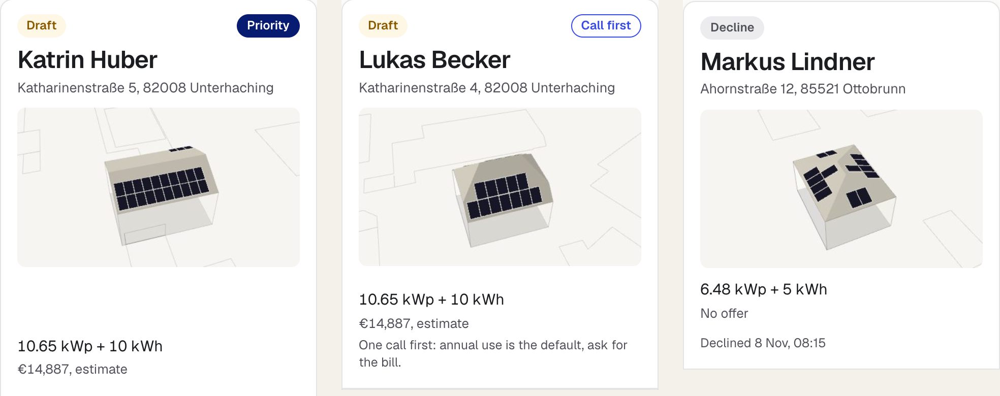
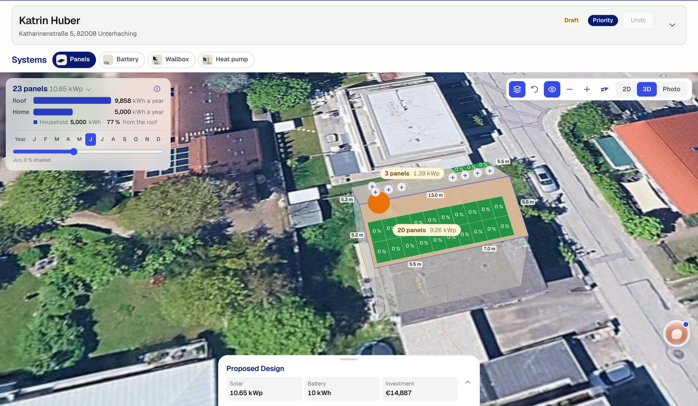

<!-- _class: blue -->
<!-- _paginate: false -->

Marquee, for Reonic

# A first draft of the whole system, with its rules and its score.

Team Marquee: Xander Lim, Zi Yuan, Jamon. thinc! hack Munich, 8 November 2026.

---

The installer’s pipeline today

## Six new enquiries, two site visits, and every size depends on the others.

“Family of four, detached house, want solar, maybe a battery. Bill attached.” panels <b>?</b>  battery <b>?</b>  wallbox <b>?</b>  heat pump <b>?</b> enquiry, qualification, design, offer, signature: each a hand step Marquee drafts each step and the planner approves it

---

<!-- _class: board -->

Enquiry: which leads deserve a visit

## Every lead arrives with a verdict and the reason a planner would give.

replayed on <b>126</b> held-out signed sales: Priority <b>80%</b>, Call first <b>18%</b>, Decline <b>2%</b>

Estimates until the site visit. Offer values come from stated cost assumptions, not quotes.

---

<!-- _class: ink split -->

Design to offer: live

# The real house, four decisions in a chain, then the offer.

the real house: Bavarian LoD2 roof, aerial photo, shade per panel four decisions in a chain, then the offer one chip changes a fact and the chain runs again: the wallbox appears intake by form, pasted email, or a call with Rina

Reonic minimum: “The planner changes at least one input or component and receives an updated design.”

---

Rules from Reonic’s 1,619 projects, the second half sealed

## Each installer’s habits, written as rules a planner can check.

installer A, panels by use: to <b>2,856 kWh</b> <b>6.3 kWp</b>, to <b>3,550</b> <b>8.1</b>, to <b>9,100</b> <b>10.35</b>, above <b>12.15</b> installer A, battery: to <b>4,100 kWh</b> the <b>5 kWh</b> pack, above it <b>10 kWh</b> installer B, panels: to <b>3,750 kWh</b> <b>7.2 kWp</b>, above <b>11.7</b>; a battery on <b>95 to 99%</b> of jobs heat pump: none unless asked, or a gas or oil boiler <b>20 years</b> or older wallbox: <b>11 kW</b> when there is a car

---

The exam: 633 sealed homes

18.6%

## All four decisions match the expert’s. The textbook rule: 6.8%.

sealed test half, <b>633</b> new-system homes the rules never saw; panels alone <b>41%</b>, battery <b>50%</b> tolerance: panels <b>±1 kWp</b> or <b>±15%</b>, battery <b>±2 kWh</b>, heat pump and wallbox decisions exact black box <b>19.0%</b>, rules <b>23.0%</b> on the <b>126</b> homes both scored, paired p <b>0.332</b>: a tie

Reonic minimum: “You measure how close your designs come to the expert designs on projects your system has not seen.”

---

<!-- _class: ink -->

Where the draft differs from the expert, and why

## Three things the record does not hold set the gap.

roof size and budget are not recorded <b>17 to 19%</b> of homes carry the <b>4,500 kWh</b> default in place of a bill a quarter of wallboxes went to homes with no car on record with an address, Marquee adds the measured roof the record lacks where the designs differ, the same simulator favours ours on 20-year value on <b>327</b> of <b>514</b> homes, the expert’s on <b>180</b> (modelled)

---

Offer to signature

## Complete sends the chosen design to the homeowner, who signs or declines.

variants: planners’ pick, best payback, most independence, lowest upfront Complete opens Send the proposal: WhatsApp, or a link to copy the homeowner page shows the completed design and nothing else the signature or the decline comes back to the board

Reonic’s chat sizes from the catalogue when asked, and the planner picks by hand. Marquee proposes unprompted, explains its rules, publishes its expert match, and hands the chosen design over to sign.

---

<!-- _class: ink -->

Inside Reonic

## Three steps to production.

rules fitted per installer, across every installer on Reonic the computed next question inside Reonic’s intake, by form or by voice meter data from installed systems back into the next rule set today each design replays through Munich’s real 2025: real weather, real day-ahead prices, <b>576</b> negative hours

Prices and weather: Energy-Charts (Fraunhofer ISE), CC BY 4.0

---

<!-- _class: blue -->
<!-- _paginate: false -->

Marquee

## Every draft shows its rules and its score, and the planner signs off the exceptions.

Xander Lim, Zi Yuan, Jamon

